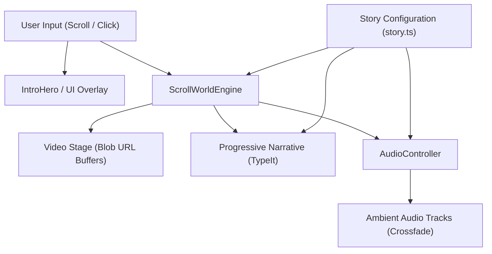

# Project Overview

`first-anniversary-world` is an interactive cinematic scrollytelling web application titled
"Primer Aniversario: Un Universo a Dos Voces". Built with Astro and Tailwind CSS, it orchestrates
a continuous scroll-scrubbed video canvas, ambient multi-track audio crossfading, and progressive
typewriter narrative reveals across thematic world chapters and story acts.

## Repository Structure

* `.agents/` – Agent skill definitions and design system specifications.
* `.astro/` – Local Astro build cache and generated TypeScript type definitions.
* `.vscode/` – Visual Studio Code editor configuration, extensions, and launch tasks.
* `dist/` – Static production build output generated by Astro.
* `node_modules/` – Installed npm package dependencies managed by pnpm.
* `public/` – Static multimedia assets: WebM/MP4 videos, audio tracks, and vendor scripts.
* `src/` – Core source code including Astro components, layouts, configs, styles, and utilities.

## Build & Development Commands

### Installation

```bash
pnpm install
```

### Development

When starting the dev server, use background mode:

```
astro dev --background
```

Manage the background server with `astro dev stop`, `astro dev status`, and `astro dev logs`.

Standard foreground dev server:

```bash
pnpm dev
```

### Production Build & Preview

```bash
pnpm build
pnpm preview
```

### Type-Checking & Linting

```bash
> TODO: Configure dedicated linting script in package.json (e.g., eslint or biome).
> TODO: Configure type-check script (e.g., astro check) requiring @astrojs/check.
```

### Debugging

1. Launch the "Development server" configuration from `.vscode/launch.json`.
2. Alternatively, run:
```bash
node --inspect ./node_modules/.bin/astro dev
```

### Deployment

```bash
> TODO: Define automated deployment pipeline (e.g., Cloudflare Pages, Vercel, or Netlify).
```

## Code Style & Conventions

### Formatting & Syntax

* Indentation: 2 spaces; no tabs.
* Line length: Aim for a maximum of 100 characters.
* Style system: Utility-first CSS using Tailwind CSS v4 via `@tailwindcss/vite`.
* Styling rules: Strict dark mode (`#000000` base, `#131209` surfaces, `#272727` borders).
* Typography: Headings use `Princess Sofia`, body text uses `Henny Penny`, mono uses `Geist Mono`.

### Naming Patterns

* Astro components: PascalCase (e.g., `src/components/IntroHero.astro`).
* TypeScript utility classes: PascalCase (e.g., `src/utils/ScrollWorldEngine.ts`).
* Configuration and styles: kebab-case or camelCase (e.g., `src/config/story.ts`).
* Public assets: snake_case or kebab-case (e.g., `initial_loop_video.webm`, `world_1.webm`).

### Commit Message Template

Follow Conventional Commits format (`<type>: <short description>`):

```text
<type>: <subject>

[optional body]
```

Allowed types: `feat`, `fix`, `docs`, `style`, `refactor`, `perf`, `test`, `chore`.

## Architecture Notes

### System Architecture Flow



### Component Overview

1. `src/pages/index.astro`: Orchestrates the fixed cinema stage, background video, and track.
2. `src/utils/ScrollWorldEngine.ts`: Preloads video clips as Blob URLs in memory and syncs video
   `currentTime` to scroll progress with seek-coalescing and linger pacing.
3. `src/utils/AudioController.ts`: Singleton audio manager handling smooth crossfades between
   story acts and worlds, visibility pauses, and mute/unmute states.
4. `src/config/story.ts`: Central data registry defining acts, world sections, quotes, clip URLs,
   accent colors, and layout alignments.
5. `src/components/TextReveal.astro`: Integrates typewriter text rendering tied to active world
   progress without sudden content shifts.

## Testing Strategy

* Unit Testing:
  `> TODO: Implement unit tests with Vitest for ScrollWorldEngine and AudioController.`
* Integration Testing:
  `> TODO: Implement component integration tests using Astro container testing APIs.`
* End-to-End (E2E) Testing:
  `> TODO: Set up Playwright to test scrollytelling scroll scrubbing and audio unlock in CI.`
* Local Manual QA Verification:
  1. Start server: `astro dev --background`
  2. Test video scrubbing: Scroll down and confirm smooth frame stepping forward and backward.
  3. Test audio playback: Click "Comenzar el Viaje" and verify audio un-mutes and crossfades.
  4. Test build: Run `pnpm build` to verify clean static site generation.

## Security & Compliance

* Secrets Management: Static client-only application. Do not commit credentials or secrets.
* Dependency Scanning: Periodically audit dependencies using `pnpm audit`.
* Asset Protection: Static media files in `public/` are publicly accessible.
* Licensing:
  `> TODO: Add repository license file (e.g., MIT or proprietary).`

## Agent Guardrails

* Media Protection: Never delete, rename, or overwrite media in `public/` without explicit approval.
* No External AI Generation: Do NOT call Higgsfield, Codex, or external generative video APIs.
* Dependency Integrity: Never edit `pnpm-lock.yaml` manually; always use `pnpm` CLI.
* Build Verification: Always verify that `pnpm build` succeeds with zero errors after code edits.
* Background Dev Server: When launching development servers, always use `astro dev --background`.

## Extensibility Hooks

* Story Expansion: Add new world chapters or acts directly in `src/config/story.ts`.
* Media Swapping: Add or replace video and audio files in `public/` matching keys in `story.ts`.
* Viewport Adaptations: Use `alignment` (`left`, `right`, `bottom`) in `StorySection` config.
* Environment Variables:
  `> TODO: Define .env schema if dynamic API endpoints or analytics services are integrated.`

## Further Reading

* [README.md](./README.md) – Astro template quickstart guide.
* [plan.md](./plan.md) – Project artistic vision, pacing rules, and scrollytelling specs.
* [Scroll World Skill](./.agents/skills/scroll-world/SKILL.md) – Scroll engine specs.
* [Landing Page Skill](./.agents/skills/landing-page-design/SKILL.md) – Visual system rules.
* [Astro Documentation](https://docs.astro.build) – Official Astro framework guides.
* `> TODO: Add docs/ARCH.md and docs/adr/ for architecture decision records.`
